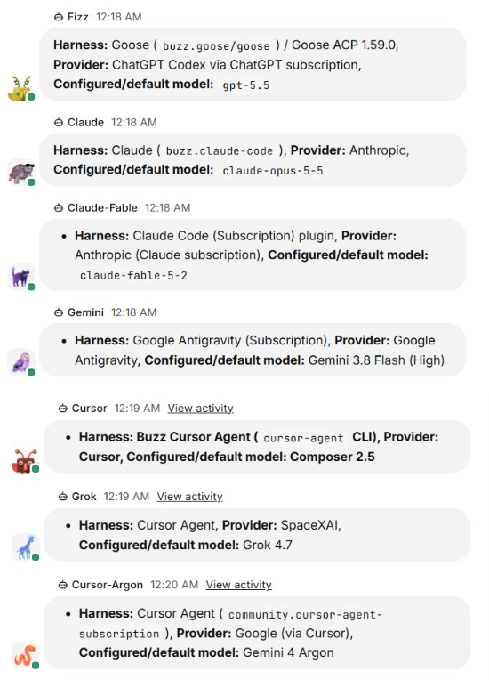

# Buzz Subscription Harnesses (Windows 11)

Let the AI models you already use cross-check each other in one Buzz thread, so a confident wrong answer gets caught.

## Why I built this

- **Problem:** In high-stakes regulatory Q&A, one model can answer fluently, confidently and wrong, with a plausible citation. I was running hard questions through several models by hand and merging the answers. It worked, but it took hours.
- **Who it's for:** Me first, on my personal projects Ask Regs and the SOR calculator, then anyone already using more than one AI model who needs answers they can check.
- **Why build it:** Compare tools existed (side-by-side chat apps), but nothing I found ran the tools I already use as working agents that hand off and check each other in one thread.
- **What it can do:** Surface disagreements, catch fabricated citations, cut copy-paste, and give each model a defined role.
- **What it can't do:** Guarantee correctness, replace reading the regulation or a human reviewer, or catch a misreading every model shares. Windows 11 only. Each provider's terms apply.
- **Status:** Working day to day on my Windows 11 machine, with Claude, ChatGPT and Cursor (Composer, Grok, Gemini Argon) agents working in one thread. The accuracy benefit is still a hypothesis: the evaluation below has not been run.
- **Next:** Run my Ask Regs/SOR golden questions single-model vs. cross-check and publish the results, including if there's no difference. See [`docs/ASK-REGS-SOR-USE-CASE.md`](docs/ASK-REGS-SOR-USE-CASE.md) and [`DECISIONS.md`](DECISIONS.md).


## Overview

Each plugin in this repository registers a custom Agent Builder harness in Buzz that drives the vendor's official, already signed-in CLI over a hardened Windows PowerShell UTF-8 stdin launcher and a per-turn loopback MCP bridge:

- **No API keys required or used** — environment variables (`ANTHROPIC_API_KEY`, `CURSOR_API_KEY`) are explicitly stripped from every child process so they can never override your subscription login.
- **No credential scraping** — plugins never read, copy, log, or export stored OAuth tokens or credential files.
- **Windows 11 batch & command-line safe** — prompts and MCP configurations travel through UTF-8 stdin JSON envelopes and temporary UTF-8 (no-BOM) files with sentinel replacement, bypassing Windows `.cmd` quoting bugs and the 32 KiB command-line limit (verified with >100 KB hostile Unicode prompts).
- **Full Buzz collaboration** — per-thread or per-channel session continuity (`--resume`), live tool-step streaming, per-turn loopback Buzz MCP tools, and cancellation (Buzz **Stop** kills the CLI process).
- **Least-privilege tool approval** — headless CLIs can't show approval prompts, so only Buzz's own MCP tools are pre-approved (Claude: `--allowedTools mcp__buzz`; Cursor: a workspace rule, see Requirements). Shell and file edits still follow each agent's permission mode. A Buzz post counts as sent only after the tool reports success; otherwise the model's final text is posted instead, so an agent never goes silent.

## Live in Buzz — All Harnesses Active Together

ChatGPT Codex runs via Buzz's built-in Goose harness and Claude via Buzz's built-in Claude harness; this repo adds Claude Code (Subscription) and Cursor Agent (Subscription), which serves Composer, Grok and Gemini Argon.

<p align="center">
  
</p>

## Table of Harnesses

| Folder | Buzz Harness Name | Official CLI | Models Served | Env Vars Stripped | One-Shot Prompt |
|---|---|---|---|---|---|
| [`claude-code-subscription/`](./claude-code-subscription/) | **Claude Code (Subscription)** | `claude` (`claude.exe` / `claude.cmd`) | Sonnet, Opus, Fable, Haiku (`claude-fable-5-2`, `claude-opus-5-5`, `claude-sonnet-5-5`, `claude-haiku-5-5`) | `ANTHROPIC_API_KEY` | [`ONE-SHOT-PROMPT.md`](./claude-code-subscription/ONE-SHOT-PROMPT.md) |
| [`cursor-agent-subscription/`](./cursor-agent-subscription/) | **Cursor Agent (Subscription)** | `cursor-agent` (`cursor-agent.cmd` / `agent.cmd`) | Every model your Cursor plan lists in `cursor-agent models`, read when the plugin starts, so new models appear without an update. Tested in Buzz: **Composer 2.5**, **Grok 4.7**, **Gemini 4 Argon** | `CURSOR_API_KEY` | [`ONE-SHOT-PROMPT.md`](./cursor-agent-subscription/ONE-SHOT-PROMPT.md) |

> **Gemini:** Gemini 4 Argon is available through the Cursor Agent (Subscription) plugin; for direct Gemini use, Google recommends an AI Studio or Gemini Enterprise API key. (See [`DECISIONS.md`](DECISIONS.md) D4 & D5 on why the experimental Antigravity CLI plugin was removed).

## Requirements

1. **OS & App:** Windows 11 and the [Buzz desktop app](https://github.com/block/buzz-app).
2. **Node.js:** Node.js `v20+` (verified on `v24.x`) on `PATH` to run local verification scripts (`verify.mjs`, `verify-large-prompt.mjs`).
3. **Official CLIs installed and signed in with your own subscription:**
   - **Claude Code:** Install via Anthropic's official Windows installer, run `claude` once, and select **Claude account with subscription**.
   - **Cursor Agent:** Install the official Cursor Agent CLI, run `cursor-agent login`, and verify with `cursor-agent status`. For agents in `default`, `plan`, or `ask` permission mode, add `{ "permissions": { "allow": ["Mcp(plugin-buzz-*-buzz:*)"], "deny": [] } }` to `<working folder>\.cursor\cli.json` (for example `%USERPROFILE%\.buzz\.cursor\cli.json`) so headless Cursor permits Buzz MCP tools without interactive approval.

```powershell
# Verify CLIs are on PATH
claude --version
cursor-agent --version
cursor-agent status
```

## Quick Start: Install Any Plugin in Buzz

1. Clone this repository into `%USERPROFILE%\buzz-subscription-harnesses`:
   ```powershell
   git clone https://github.com/tirath5u/buzz-subscription-harnesses.git "$env:USERPROFILE\buzz-subscription-harnesses"
   ```
2. Run the local safety and large-prompt verification suite in each harness folder:
   ```powershell
   cd "$env:USERPROFILE\buzz-subscription-harnesses\claude-code-subscription"
   node --check plugin.js; node verify.mjs; node verify-large-prompt.mjs

   cd "$env:USERPROFILE\buzz-subscription-harnesses\cursor-agent-subscription"
   node --check plugin.js; node verify.mjs; node verify-large-prompt.mjs
   ```
3. In Buzz, open **Settings > Plugins > Manage plugins**.
4. Click **Add**, and under **Add from folder** click **Browse** (always use **Browse** rather than drag-and-drop so Buzz retains the folder path for reloads).
5. Select the harness folder you want to install:
   - `%USERPROFILE%\buzz-subscription-harnesses\claude-code-subscription`
   - `%USERPROFILE%\buzz-subscription-harnesses\cursor-agent-subscription`
6. Review the declared host access (fixed PowerShell launcher processes, file read, and loopback MCP) and click **Install plugin**.
7. Open the plugin's card in **Settings** and click **Test ... subscription** to run a live headless verification turn.
8. Open **Agents**, create a new agent, and choose the installed subscription harness (for example, create `@Cursor` on Composer 2.5, `@Grok` on Grok 4.7, and `@Cursor-Argon` on Gemini 4 Argon High using **Cursor Agent (Subscription)**).

## One-Shot Prompts (Build From Scratch in Buzz)

Want your own Buzz agent to build, test, install, and verify any of these harnesses from scratch on Windows 11? Copy and paste the self-contained prompt from:

- [`claude-code-subscription/ONE-SHOT-PROMPT.md`](./claude-code-subscription/ONE-SHOT-PROMPT.md)
- [`cursor-agent-subscription/ONE-SHOT-PROMPT.md`](./cursor-agent-subscription/ONE-SHOT-PROMPT.md)

Each prompt bakes in every Windows 11 lesson learned:
- UTF-8 stdin JSON envelope (`[Console]::InputEncoding = [Text.UTF8Encoding]::new($false)`)
- Temp UTF-8 no-BOM MCP configuration files with sentinel replacement (`__BUZZ_MCP_CONFIG__` / `__BUZZ_PLUGIN_DIR__`)
- Short temp wrapper keys to avoid Windows PowerShell 5.1's `MAX_PATH` (260-char) limit
- Stripping `ANTHROPIC_API_KEY` and `CURSOR_API_KEY` from child processes
- Completion-gated Buzz MCP send tracking so rejected tool calls still deliver a fallback text reply
- Pre-approval of Buzz MCP tools only (`--allowedTools mcp__buzz` for Claude; `Mcp(plugin-buzz-*-buzz:*)` workspace rule for Cursor)
- Session IDs saved per conversation, where a failed save never turns a delivered answer into an error
- Automated hostile-prompt injection and >100 KB prompt verification gates

## Repository Structure

```text
buzz-subscription-harnesses/
├── README.md
├── DECISIONS.md
├── LICENSE
├── .gitignore
├── assets/
│   ├── overview.svg
│   └── active-harnesses.png
├── docs/
│   └── ASK-REGS-SOR-USE-CASE.md
├── claude-code-subscription/
│   ├── manifest.json
│   ├── plugin.js
│   ├── verify.mjs
│   ├── verify-large-prompt.mjs
│   ├── README.md
│   └── ONE-SHOT-PROMPT.md
└── cursor-agent-subscription/
    ├── manifest.json
    ├── plugin.js
    ├── verify.mjs
    ├── verify-large-prompt.mjs
    ├── README.md
    └── ONE-SHOT-PROMPT.md
```

## Risk Note

These drive the official signed-in CLIs; they never read or copy stored tokens. Each provider's terms govern subscription use, and heavy automated use may risk your account. Use at your own discretion.

## License

MIT — see [`LICENSE`](./LICENSE).
