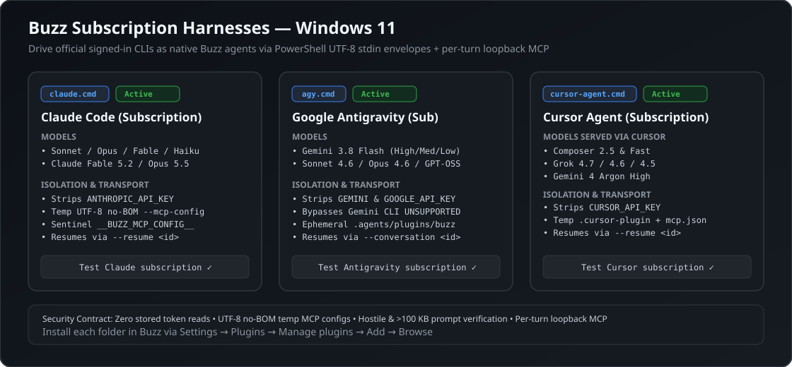

# Buzz Subscription Harnesses (Windows 11)

Run your existing **Claude Pro/Max**, **Google Antigravity (Gemini)**, and **Cursor** subscriptions as first-class native agents inside [Buzz](https://github.com/block/buzz-app) on Windows 11—with **one-shot build prompts** and **ready-to-install plugin folders**.



## Overview

Each plugin in this repository registers a custom Agent Builder harness in Buzz that drives the vendor's official, already signed-in CLI over a hardened Windows PowerShell UTF-8 stdin launcher and a per-turn loopback MCP bridge:

- **No API keys required or used** — environment variables (`ANTHROPIC_API_KEY`, `GEMINI_API_KEY`, `GOOGLE_API_KEY`, `CURSOR_API_KEY`) are explicitly stripped from every child process so they can never override your subscription login.
- **No credential scraping** — plugins never read, copy, log, or export stored OAuth tokens or credential files.
- **Windows 11 batch & command-line safe** — prompts and MCP configurations travel through UTF-8 stdin JSON envelopes and temporary UTF-8 (no-BOM) files with sentinel replacement, bypassing Windows `.cmd` quoting bugs and the 32 KiB command-line limit (verified with >100 KB hostile Unicode prompts).
- **Full Buzz collaboration** — per-thread or per-channel session continuity (`--resume` / `--conversation`), live tool-step streaming, per-turn loopback Buzz MCP tools, and clean process cancellation.

## Table of Harnesses

| Folder | Buzz Harness Name | Official CLI | Models Served | Env Vars Stripped | One-Shot Prompt |
|---|---|---|---|---|---|
| [`claude-code-subscription/`](./claude-code-subscription/) | **Claude Code (Subscription)** | `claude` (`claude.exe` / `claude.cmd`) | Sonnet, Opus, Fable, Haiku (`claude-fable-5-2`, `claude-opus-5-5`, `claude-sonnet-5-5`, `claude-haiku-5-5`) | `ANTHROPIC_API_KEY` | [`ONE-SHOT-PROMPT.md`](./claude-code-subscription/ONE-SHOT-PROMPT.md) |
| [`antigravity-subscription/`](./antigravity-subscription/) | **Google Antigravity (Subscription)** | `agy` (`agy.cmd` / `agy.exe`) | Gemini 3.8 Flash (High/Med/Low), Claude Sonnet 4.6, Claude Opus 4.6, GPT-OSS 120B | `GEMINI_API_KEY`, `GOOGLE_API_KEY` | [`ONE-SHOT-PROMPT.md`](./antigravity-subscription/ONE-SHOT-PROMPT.md) |
| [`cursor-agent-subscription/`](./cursor-agent-subscription/) | **Cursor Agent (Subscription)** | `cursor-agent` (`cursor-agent.cmd` / `agent.cmd`) | Serves **Composer** (`composer-2.5`, `composer-2.5-fast`), **Grok** (`grok-4.7-*`, `cursor-grok-4.6-*`, `cursor-grok-4.5-*`), and **Gemini Argon** (`gemini-4-argon-high`) models via Cursor | `CURSOR_API_KEY` | [`ONE-SHOT-PROMPT.md`](./cursor-agent-subscription/ONE-SHOT-PROMPT.md) |

> **Known Gotcha — Why Antigravity (`agy`) Instead of the Standalone `gemini` CLI:**
> The official standalone Gemini CLI (`gemini`) rejects free-tier and standard consumer Google accounts with `UNSUPPORTED_CLIENT`. Google Antigravity's official CLI (`agy`) works natively with signed-in Google accounts in headless `stream-json` mode, which is why `antigravity-subscription` drives `agy`.

## Requirements

1. **OS & App:** Windows 11 and the [Buzz desktop app](https://github.com/block/buzz-app).
2. **Node.js:** Node.js `v20+` (verified on `v24.x`) on `PATH` to run local verification scripts (`verify.mjs`, `verify-large-prompt.mjs`).
3. **Official CLIs installed and signed in with your own subscription:**
   - **Claude Code:** Install via Anthropic's official Windows installer, run `claude` once, and select **Claude account with subscription**.
   - **Google Antigravity:** Install Google Antigravity, sign in, and register the CLI on `PATH` with `agy install`.
   - **Cursor Agent:** Install the official Cursor Agent CLI, run `cursor-agent login`, and verify with `cursor-agent status`.

```powershell
# Verify all three CLIs are on PATH
claude --version
agy --version
cursor-agent --version
cursor-agent status
```

## Quick Start: Install Any Plugin in Buzz

1. Clone this repository into `%USERPROFILE%\buzz-subscription-harnesses`:
   ```powershell
   git clone https://github.com/tirath5u/buzz-subscription-harnesses.git "%USERPROFILE%\buzz-subscription-harnesses"
   ```
2. Run the local safety and large-prompt verification suite in each harness folder:
   ```powershell
   cd "%USERPROFILE%\buzz-subscription-harnesses\claude-code-subscription"
   node --check plugin.js; node verify.mjs; node verify-large-prompt.mjs

   cd "%USERPROFILE%\buzz-subscription-harnesses\antigravity-subscription"
   node --check plugin.js; node verify.mjs; node verify-large-prompt.mjs

   cd "%USERPROFILE%\buzz-subscription-harnesses\cursor-agent-subscription"
   node --check plugin.js; node verify.mjs; node verify-large-prompt.mjs
   ```
3. In Buzz, open **Settings > Plugins > Manage plugins**.
4. Click **Add**, and under **Add from folder** click **Browse** (always use **Browse** rather than drag-and-drop so Buzz retains the folder path for reloads).
5. Select the harness folder you want to install:
   - `%USERPROFILE%\buzz-subscription-harnesses\claude-code-subscription`
   - `%USERPROFILE%\buzz-subscription-harnesses\antigravity-subscription`
   - `%USERPROFILE%\buzz-subscription-harnesses\cursor-agent-subscription`
6. Review the declared host access (fixed PowerShell launcher processes, file read, and loopback MCP) and click **Install plugin**.
7. Open the plugin's card in **Settings** and click **Test ... subscription** to run a live headless verification turn.
8. Open **Agents**, create a new agent, and choose the installed subscription harness (for example, create `@Cursor` on Composer 2.5, `@Grok` on Grok 4.7, and `@Cursor-Argon` on Gemini 4 Argon High using **Cursor Agent (Subscription)**).

## One-Shot Prompts (Build From Scratch in Buzz)

Want your own Buzz agent to build, test, install, and verify any of these harnesses from scratch on Windows 11? Copy and paste the self-contained prompt from:

- [`claude-code-subscription/ONE-SHOT-PROMPT.md`](./claude-code-subscription/ONE-SHOT-PROMPT.md)
- [`antigravity-subscription/ONE-SHOT-PROMPT.md`](./antigravity-subscription/ONE-SHOT-PROMPT.md)
- [`cursor-agent-subscription/ONE-SHOT-PROMPT.md`](./cursor-agent-subscription/ONE-SHOT-PROMPT.md)

Each prompt bakes in every Windows 11 lesson learned:
- UTF-8 stdin JSON envelope (`[Console]::InputEncoding = [Text.UTF8Encoding]::new($false)`)
- Temp UTF-8 no-BOM MCP configuration files with sentinel replacement (`__BUZZ_MCP_CONFIG__` / `__BUZZ_PLUGIN_DIR__`)
- Short temp wrapper keys to avoid Windows PowerShell 5.1's `MAX_PATH` (260-char) limit
- Stripping `ANTHROPIC_API_KEY`, `GEMINI_API_KEY`, `GOOGLE_API_KEY`, and `CURSOR_API_KEY` from child processes
- Completion-gated Buzz MCP send tracking so rejected tool calls still deliver a fallback text reply
- Resilient session state persistence (`Map` + `try/catch` around `agents.storage.set`)
- Automated hostile-prompt injection and >100 KB prompt verification gates

## Repository Structure

```text
buzz-subscription-harnesses/
├── README.md
├── LICENSE
├── .gitignore
├── assets/
│   └── overview.svg
├── claude-code-subscription/
│   ├── manifest.json
│   ├── plugin.js
│   ├── verify.mjs
│   ├── verify-large-prompt.mjs
│   ├── README.md
│   └── ONE-SHOT-PROMPT.md
├── antigravity-subscription/
│   ├── manifest.json
│   ├── plugin.js
│   ├── verify.mjs
│   ├── verify-large-prompt.mjs
│   ├── README.md
│   └── ONE-SHOT-PROMPT.md
└── cursor-agent-subscription/
    ├── manifest.json
    ├── plugin.js
    ├── verify.mjs
    ├── verify-large-prompt.mjs
    ├── README.md
    └── ONE-SHOT-PROMPT.md
```

## Risk Note

These drive the official signed-in CLIs; they never read or copy stored tokens. Each provider's terms govern subscription use, and heavy automated use may risk your account. Use at your own discretion.

## License

MIT — see [`LICENSE`](./LICENSE).
