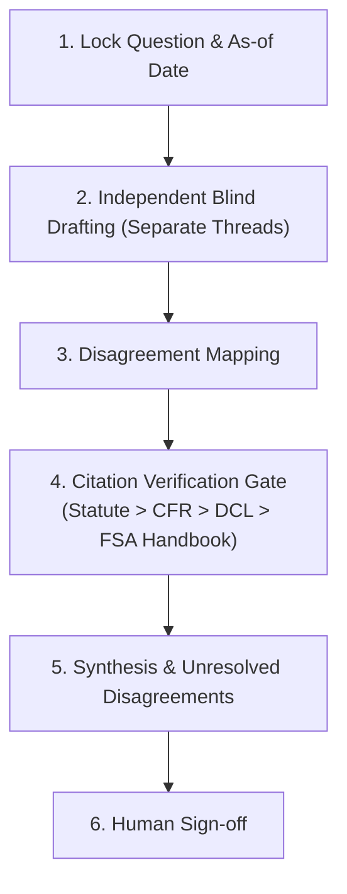

# Ask Regs & SOR Calculator: Multi-Model Cross-Check Use Case

> **Scope Note:** This document covers personal open research and evaluation projects only (Ask Regs and the SOR calculator). It contains no employer data, no student data, no proprietary code, and no live customer answers.

---

## 1. Context & Motivation

In high-stakes regulatory Q&A (such as Title IV federal student aid regulations and institutional refund calculations), a single AI model can produce answers that appear fluent, authoritative, and completely persuasive—while citing non-existent regulatory subsections or subtly reversing statutory conditions.

Merging outputs from multiple models manually by copy-pasting between browser tabs worked to surface discrepancies, but the process took hours. This workflow formalizes multi-model cross-checking inside Buzz, giving each frontier model a defined role based on its empirical strengths.

---

## 2. Defined Model Roles

Each model is assigned a specific operational mandate to prevent homogeneous groupthink:

| Participant | Model / Harness | Operational Role | Responsibility & Constraints |
|---|---|---|---|
| **Grok** | Grok 4.7 (Cursor Agent) | Researcher for Recent Changes | Scans recent regulatory changes, announcements, and policy guidance. Produces exploratory leads, never accepted as authoritative on its own. |
| **Gemini Argon** | Gemini 4 Argon High (Cursor Agent) | Skeptic on Legal Reasoning | Identifies counterexamples, alternative statutory readings, and edge-case exceptions. Challenges assumptions in draft arguments. |
| **GPT-5.5** | GPT-5.5 (ChatGPT Codex via Goose) | Independent Drafter | Produces a clean, structured initial legal/regulatory draft strictly from primary sources. |
| **Claude** | Claude Opus 5.5 / Sonnet (Claude Harness) | Synthesizer | Compares independent drafts, maps consensus vs. disagreement, and compiles the final synthesis. **Rule:** Claude never grades or validates its own synthesis. |
| **Composer** | Composer 2.5 (Cursor Agent) | Code Implementer | Implements evaluation runners, harness automation, and calculator code. Has no authority over regulatory interpretation or citations. |
| **Human Reviewer (Me)** | Human in the Loop | Final Sign-Off | Reviews all verified citations, resolves flagged disagreements, and makes the authoritative determination. |

---

## 3. The Cross-Checking Verification Loop

The verification pipeline operates under strict evidentiary rules:

1. **Lock Question & Date:** The prompt question and an authoritative "as of" date are frozen to ensure models evaluate the same historical regulatory framework.
2. **Blind Independent Answers:** Initial drafts are generated independently across isolated threads (planned automation) to avoid early bias or anchoring.
3. **Disagreement Mapping:** The system lists every substantive discrepancy between model interpretations, statutory scopes, or timeline calculations.
4. **Citation Check Gate:** Every cited source is verified against primary regulatory text under a strict hierarchy:
   $$\text{Statute (HEA)} > \text{Code of Federal Regulations (CFR)} > \text{Dear Colleague Letters (DCL)} > \text{FSA Handbook}$$
   - **Hard Fail Rule:** A failed or fabricated citation immediately fails the corresponding answer.
   - **No Skipping:** Model agreement *never* skips the citation verification check; multiple models can share the same hallucinated citation.
5. **Synthesis with Visible Disagreement:** The synthesizer compiles verified citations into a unified summary while keeping unresolved ambiguities explicitly visible.
6. **Human Sign-Off:** The human reviewer reviews primary sources and gives final approval.

---

## 4. Evaluation Plan

To determine whether multi-model cross-checking provides a measurable accuracy improvement over single-model generations:

- **Golden Dataset:** 60–100 curated regulatory questions with complete, human-verified answer keys prepared before running evaluations.
- **Experimental Arms:**
  1. **Single Model (Baseline):** Best single frontier model answering in isolation.
  2. **Majority Vote:** 3-model majority agreement across independent generations.
  3. **Full Cross-Check Loop:** Complete multi-model verification loop with defined roles and mandatory citation gates.
- **Evaluation Metrics:**
  - **Correct-and-Cited Rate:** Percentage of answers fully correct with 100% verified primary citations.
  - **Confident-Wrong Rate:** Frequency of plausible, fluent answers containing legal or factual errors.
  - **Fabricated-Citation Rate:** Frequency of non-existent regulatory citations or misattributed clauses.
  - **Minutes per Answer:** Total time elapsed from prompt submission to verified output.
- **Blinding:** Answer scoring and verification are conducted blind to which arm produced the response.

---

## 5. Evaluation Status & Results

- **Status:** Not yet run.
- Results and metrics will be published here upon completion of the evaluation suite.

---

## 6. Operating Boundaries & Safety Limits

- **No Student Data or PII:** Never used with Personally Identifiable Information (PII), student financial aid records, or non-public data.
- **No Live Customer Operations:** Strictly for personal evaluation, development tooling, and asynchronous research.
- **Asynchronous Only:** Not intended for real-time or low-latency production API deployments.
